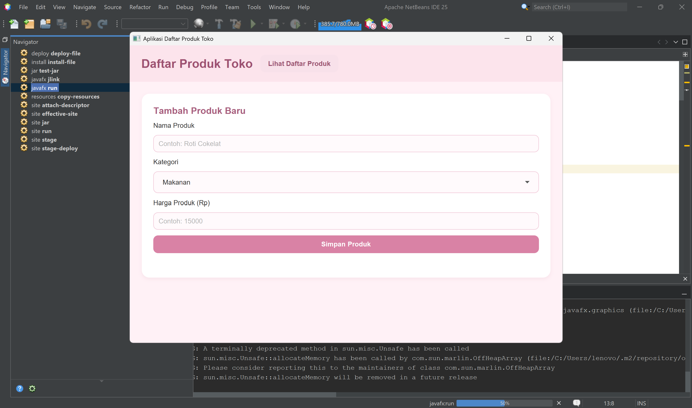
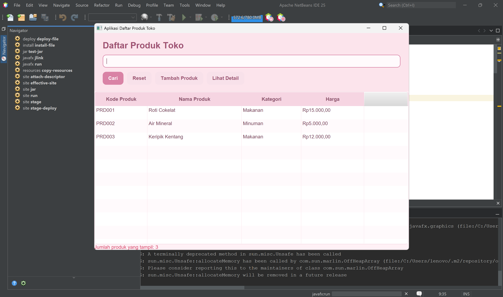

# APLIKASI DAFTAR PRODUK TOKO

Project Apache NetBeans berbasis JavaFX dan Maven untuk mengelola daftar produk toko.

## CARA MENJALANKAN

1. Buka project Daftar Produk Toko menggunakan Apache NetBeans IDE 25.
2. Pastikan konfigurasi JavaFX dan dependensi Maven sudah tersedia dengan benar.
3. Lakukan Clean and Build untuk memeriksa dan membangun project.
4. Jika proses build berhasil, jalankan aplikasi melalui Maven dengan perintah javafx:run.
5. Tunggu beberapa saat hingga tampilan aplikasi Daftar Produk Toko muncul.
6. Isi nama produk, pilih kategori produk (Makanan atau Minuman), dan masukkan harga produk.
7. Tekan tombol Tambah untuk memasukkan produk ke dalam tabel daftar produk.
8. Gunakan fitur Cari untuk mencari produk berdasarkan nama.
9. Pilih salah satu produk pada tabel untuk melihat detail informasi produk.

## FITUR APLIKASI

- Menambahkan produk dengan kode otomatis (PRD001, PRD002, dan seterusnya).
- Memilih kategori produk Makanan atau Minuman.
- Validasi nama produk wajib diisi dan harga harus lebih dari nol.
- Menampilkan daftar produk dalam tabel berisi kode, nama, kategori, dan harga.
- Mencari produk berdasarkan nama melalui tombol Cari.
- Menampilkan detail produk yang dipilih dari tabel.
- Menyimpan data di memori selama aplikasi berjalan (tidak menggunakan database).

## SCREENSHOT APLIKASI

## CONTOH DATA UNTUK PENGUJIAN

| Nama Produk | Kategori | Harga |
|---|---|---:|
| Roti Cokelat | Makanan | 15000 |
| Air Mineral | Minuman | 5000 |
| Keripik Kentang | Makanan | 12000 |
